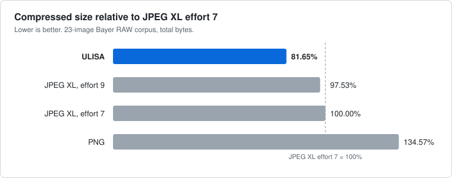

# PKON

**An image-compression tool within the [KON](https://github.com/Kernel-of-Optimized-Networks-KON/kon-app) multimedia ecosystem.**

PKON provides specialized lossless compression for standard images and RAW photographs through the `.pkon` container format. KON is designed to bring specialized compression tools for multiple media types together under one ecosystem, with image compression as its starting point and lossless audio as the next planned expansion. Audio is not implemented yet, and PKON does not support it.

PKON is the compression tool; the KON desktop application is the separate, user-facing application in the ecosystem that provides access to it.

PKON uses three specialized codecs:

- **ELLIE** for standard images (PNG and JPEG).
- **ULISA** for Bayer RAW DNG.
- **LISA** for supported RAW data outside ULISA's Bayer path, such as monochrome or X-Trans mosaics.

## ULISA v1

**Lossless compression built specifically for Bayer RAW photography.**

ULISA is a specialized lossless codec for the raw sensor data inside DNG files. On a 23-image Bayer RAW benchmark it produced files **18.35% smaller than JPEG XL (effort 7)** and **16.28% smaller than JPEG XL (effort 9)**. Every image decoded back to exactly the original sensor samples.

## Benchmark results

Total compressed size across 23 Bayer RAW images (816,424,128 bytes uncompressed). Every output was decoded and checked against its source: **23 of 23 images were reconstructed exactly by every codec.**

| Comparison | ULISA result |
|---|---:|
| **Smaller than JPEG XL (effort 7)** | **18.35%** |
| **Smaller than JPEG XL (effort 9)** | **16.28%** |
| Smaller than PNG | 39.32% |
| Smaller than Lisa | 5.00% |



*Total compressed size across the 23-image benchmark corpus, shown relative to JPEG XL effort 7 (= 100%). Lower is better.*

ULISA was smaller than JPEG XL (both efforts), PNG and Lisa on **all 23 images**. It also beat ELLIE on 19 of 23 images, with an aggregate size reduction of 1.24%.

| Codec | Total bytes | Compression ratio | ULISA is smaller by |
|---|---:|---:|---:|
| **ULISA** | **338,186,389** | **2.414** | |
| ELLIE | 342,420,617 | 2.384 | 1.24% |
| Lisa | 355,991,419 | 2.293 | 5.00% |
| JPEG XL, effort 9 | 403,972,838 | 2.021 | 16.28% |
| JPEG XL, effort 7 | 414,184,074 | 1.971 | 18.35% |
| PNG (16-bit gray) | 557,351,642 | 1.465 | 39.32% |

Per image, ULISA's margin over JPEG XL effort 7 ranged from 6.2% to 30.4% (median 18.9%), and over effort 9 from 4.9% to 27.2% (median 17.5%). The gain over JPEG XL was similar on the images set aside as held-out when ULISA was developed (7 images, 19.8% smaller than effort 9) and on the rest (16 images, 15.2% smaller).

**What this means in practice:** smaller RAW archives, less storage, and less data to move, with no loss of sensor information.

### Trade-offs

ULISA spends more computation than a general-purpose codec to get these sizes. Single-thread results on the same 23 images:

| Codec | Encode (Mpx/s) | Decode (Mpx/s) |
|---|---:|---:|
| PNG | 6.04 | 104.0 |
| ELLIE | 4.49 | 4.02 |
| **ULISA** | **3.81** | **3.29** |
| JPEG XL, effort 7 | 2.66 | 6.31 |
| Lisa | 1.23 | 1.24 |
| JPEG XL, effort 9 | 0.55 | 5.91 |

ULISA encodes faster than JPEG XL at both efforts and decodes more slowly than JPEG XL. If decode speed matters more than size, JPEG XL or PNG is the better fit.

### Methodology

- **Corpus:** 23 Bayer RAW images from the 25-image set in `benchmarks/ulisa-codec7-corpus/`, stored as 16-bit sample containers, with bit depths of 8, 10, 12, 14 and 16. The set covers Pentax, Leica, Ricoh, Sigma, Hasselblad, Samsung, Canon, cinema, phone and drone cameras. The images are the stored DNG rasters, unmodified. Two of the 25 are excluded from the comparisons: an X-Trans image (not a 2x2 Bayer layout, which ULISA, ELLIE and Lisa do not accept) and an odd-height image for which the ELLIE comparison could not be built.
- **What was compared:** complete files for each codec. ELLIE, Lisa and ULISA are PKON v2 containers. JPEG XL sizes are the bare codestream, with the 49-byte ISOBMFF wrapper that ffmpeg adds removed. PNG was written as 16-bit gray with best compression and adaptive filtering.
- **JPEG XL settings:** ffmpeg 9.0.2 with libjxl, `-distance 0` (lossless), `-effort 7` and `-effort 9`, `-threads 1`, gray 16-bit input.
- **Verification:** every produced file was decoded from its own bytes and compared with the source, with 0 mismatches and 0 decode failures.
- **Timing:** best of 2 runs per image, codec and direction, run sequentially and single-threaded in a release build on one laptop (i7-1185G7, 16 GB, Windows 11). ffmpeg timings include process spawn and temporary-file I/O, with a measured per-call floor subtracted. Timings carry laptop noise.
- **Scope:** this is one benchmark of 23 images, mostly one camera per family. It does not cover every camera, sensor or RAW workflow, and results on other data may differ. ULISA's margin over ELLIE is small and uneven (near zero on several camera families), so treat the 1.24% figure as indicative.

Full report, per-image tables and raw results: [benchmarks/ulisa-codec7-corpus/20261102-204357Z-corpus25-bayer/report.md](benchmarks/ulisa-codec7-corpus/20261102-204357Z-corpus25-bayer/report.md).

## Why a specialized codec

JPEG XL is an excellent general-purpose image codec, and it handles photographs, graphics and many other kinds of images well. ULISA is built for one domain: the raw mosaic from a Bayer sensor. It is an alternative for that kind of data, not a replacement for general-purpose codecs.

A Bayer sensor records one colour per photosite in a repeating 2x2 pattern, so neighbouring samples in the file belong to different colour channels. A general-purpose codec sees this as pixel data and has to find that structure itself. ULISA is designed around it.

## How ULISA works

1. **Bayer-aware prediction.** The mosaic is split into its four colour-position planes, such as the red, two green and blue sites of an RGGB sensor. Each plane is predicted from its own already-coded neighbours, which share a colour channel and are therefore much more strongly correlated than neighbouring samples in the mixed mosaic.
2. **Cross-plane flank context.** When a sample is coded, the planes coded before it supply extra information. The residuals at the sites that sit directly beside it in the original mosaic (horizontally and vertically) feed the probability model as context. Prediction errors tend to be similar at adjacent sites, so this sharpens the model's estimate of the next residual.
3. **Adaptive entropy coding.** Residuals are coded with a context-mixing probability model and a range coder. The model learns the statistics of each image as it goes, so it needs no tuning per camera or per file.
4. **L1 normalization.** Some sensors only use a regular subset of the available sample values (every *g*-th value, offset from zero). Where ULISA detects this across the whole image, it codes the samples on the smaller lattice and restores the original values exactly on decode. It is applied only when it holds for every sample, and it does not change the output.

The prediction, context and coding steps are integer-only, so the decoder reproduces the encoder's decisions exactly.

## Capabilities

- **Input formats:** DNG, PNG and JPG.
  - **DNG** is compressed from its stored raster, unmodified: no crop, black-level subtraction, white balance, scaling or demosaic. Bit depths from 1 to 16 are supported. Only single-plane CFA or monochrome RAW is accepted, with 8-bit or 16-bit unsigned integer storage.
  - **PNG** is supported for 8-bit gray, gray+alpha, RGB and RGBA images.
  - **JPG** is compressed from its decoded pixels. The original JPEG bytes, EXIF and ICC profile cannot be recovered.
  - JPEG XL input is not supported.
- **Output:** a PKON v2 container with the `.pkon` extension. The format is specified in [docs/pkon-format-v2.md](docs/pkon-format-v2.md).
- **Bayer RAW:** a valid 2x2 RGB Bayer mosaic (for example RGGB, BGGR, GRBG or GBRG), at least 2x2 samples, is written with the ULISA Bayer codec (codec id 7). The reported benchmark covers this path.
- **Non-Bayer and monochrome RAW:** a mosaic ULISA's Bayer frame cannot represent, such as an X-Trans CFA, a monochrome sensor or a mosaic smaller than 2x2, is still compressed losslessly. It falls back to the older Lisa RAW path (codec id 4), and the converter's report records that the fallback was used. The 23-image benchmark does not measure the fallback path.
- **Standard images** (PNG, JPG) are coded with the ELLIE engine inside the same container.
- **Decoding:** a `.pkon` file decodes to PNG (standard images) or to the exact sample values as a `.u16` or `.u8` export (RAW), with a `.json` metadata file. Each conversion reports sizes, ratio and SHA-256 hashes.
- **Exact reconstruction:** the container stores a CRC-32 of the samples and decoding is verified against it.

## Getting started

This repository ships PKON as a local converter with a web interface (ULISA v1). It is separate from the KON desktop application, which is released from the [kon-app repository](https://github.com/Kernel-of-Optimized-Networks-KON/kon-app). Nothing is uploaded and nothing is stored on disk.

**Prerequisites**

- A [Rust toolchain](https://rustup.rs/).
- For DNG input: Python 3 with `numpy` and `tifffile`. The converter calls `python` on Windows and `python3` elsewhere; set `PKON_PYTHON` to use a different interpreter.

**Launch** (from the repository root):

```
cargo run --release --bin serve
```

Then open **http://127.0.0.1:8080/**. Press Ctrl+C in the terminal to stop the server. To use another port, pass it as an argument: `cargo run --release --bin serve -- 9000`. The server listens on localhost only.

**Compress:** choose a DNG, PNG or JPG file in the page and select *Convert to ULISA*. The result downloads as a `.pkon` file.

**Decompress:** choose a `.pkon` file and select *Decode ULISA*. Standard images restore to PNG. RAW files restore to their exact samples as `.u16` or `.u8`, plus a `.json` metadata file. The page also has a viewer that opens a `.pkon` file in a new tab without converting it.

There is no separate command-line compressor in v1.

## Privacy

The PKON converter runs entirely on your machine. Your images are processed locally and are never uploaded, tracked or collected.

## Build, test and report issues

```
cargo build --release
cargo test --release
```

Some tests need FFmpeg and local datasets, and skip if they are missing. To run the benchmark harness, see `benchmarks/ulisa-codec7-corpus/`; it needs FFmpeg with libjxl and the local RAW corpus, which is not included in the repository.

Report bugs at **https://github.com/varman96/pkon/issues**. Include your OS, the input format and properties (dimensions, bit depth, camera and CFA layout for DNG), steps to reproduce, and whether decoded output differs from the source. Please don't attach private images; describe the file instead.

Contributions are welcome. Keep changes focused, preserve exact reconstruction, and back any compression or performance claim with reproducible benchmark evidence.

## License

PolyForm Noncommercial License 1.0.0. See [LICENSE](LICENSE).
